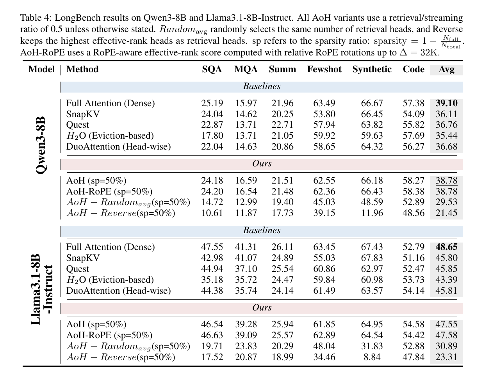
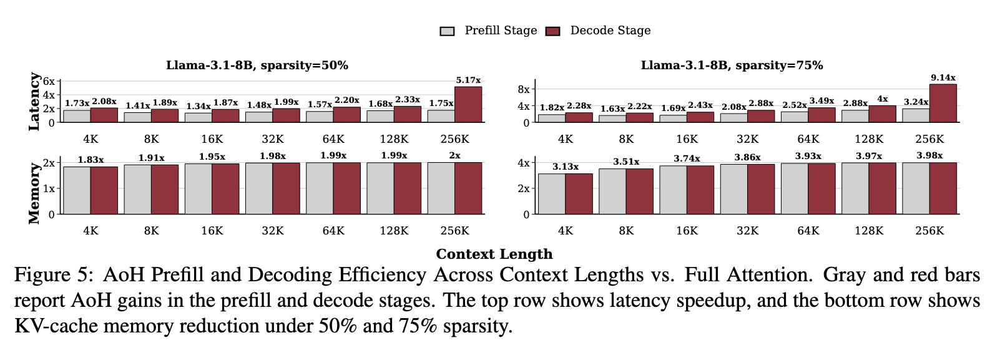
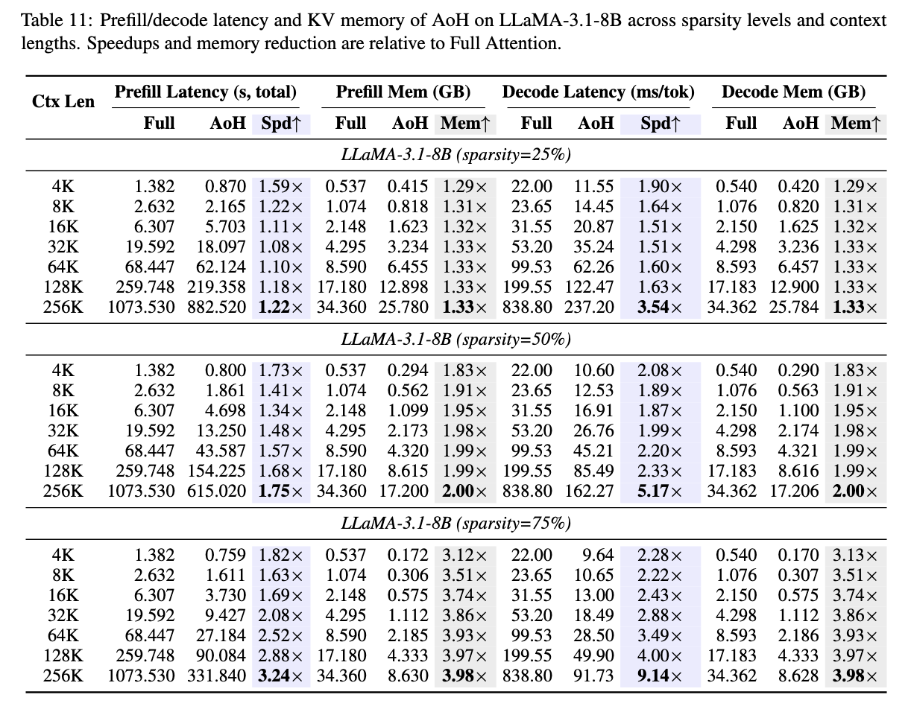

<div align="center">

<h2 align="center">
<a href="https://github.com/ernie-research/AoH">Autonomy-of-Heads: Data-Free Sparse Attention from Frozen Query-Key Geometry </a>
</h2>

<h5 align="center">If you like our project, please give us a star ⭐ on GitHub for latest update.</h5>

<p align="center">
  <a href="https://undground.fun/aoh/">
    
  </a>
  <a href="https://arxiv.org/abs/2608.06849">
    
  </a>
  <!-- <a href="https://huggingface.co/ernie-research/AVIOT">
    
  </a> -->
</p>

</div>

## Performance

**AoH (Autonomy-of-Heads)**, a training-free method that classifies attention heads from the frozen query-key projection geometry.
<div align="center">
  
  
</div>

## Demo
https://github.com/user-attachments/assets/081e901d-3fec-4d57-bc47-cb619e748221

## Method
<div align="center">
  
</div>

For each query head, AoH measures the effective rank of the query-key interaction matrix using a small head-dimension Gram matrix. Low-rank heads are classified as retrieval heads and retain full attention; higher-rank heads are classified as streaming heads and can use a local attention window.

Both multi-head attention (MHA) and grouped-query attention (GQA) models are supported. For GQA, per-query-head scores are aggregated within each KV group using the mean, minimum, or maximum score.

## Installation

Python 3.10 or newer is required.

```bash
pip install -e .
```

Install plotting dependencies when visualization is needed:

```bash
pip install -e ".[visualization]"
```

Install LongBench evaluation dependencies before running the result scripts:

```bash
pip install -e ".[evaluation]"
```

Model weights are loaded through Hugging Face Transformers. Access to gated models must be configured separately with Hugging Face.

## Command Line

```bash
python -m aoh \
  --model_path Qwen/Qwen2.5-7B \
  --device cuda:0 \
  --sparsity 0.5 \
  --agg mean \
  --output_dir outputs/qwen25-7b
```

The installed `aoh` command provides the same interface:

```bash
aoh --model_path Qwen/Qwen2.5-7B --output_dir outputs/qwen25-7b
```

Useful options:

- `--sparsity`: fraction of heads classified as streaming in each layer.
- `--agg {mean,min,max}`: GQA score aggregation strategy.
- `--binary`: use binary projection weights for accelerated rank estimation.
- `--torch_dtype {auto,float32,float16,bfloat16}`: checkpoint loading dtype; `auto` preserves the stored dtype and is the default. AoH still performs the Q/K rank computation in float32.

Run `python -m aoh --help` for the complete interface.

## Python API

```python
from aoh import AoHClassifier

classifier = AoHClassifier(
    model_path="Qwen/Qwen2.5-7B",
    device="cuda:0",
    agg="mean",
)
labels = classifier.classify(sparsity=0.5)
classifier.save("outputs/qwen25-7b")
```

`labels` has shape `(num_layers, num_kv_heads)` for GQA models and `(num_layers, num_heads)` for MHA models. A value of `1` denotes a retrieval head and `0` denotes a streaming head.

## Outputs

Each run writes the following files to `--output_dir`:

- `head_classification.npy`: binary retrieval/streaming labels.
- `eff_rank.npy`: per-query-head effective ranks.
- `eff_rank_kv.npy`: effective ranks aggregated by KV group.
- `results.json`: model and run metadata.

## Examples

```bash
python examples/qwen25_7b.py
python examples/qwen3.py
```

The examples load full model weights. Adjust the model name, device, and output path in each script for your environment.


## Results
```bash
bash scripts/run_result_eval.sh
```
We evaluate AoH on LongBench, a long-context understanding suite covering 21 tasks across six categories. The evaluated models are Qwen3-8B, Llama-3.1-8B-Instruct, and Qwen2.5-7B. Unless otherwise stated, streaming heads retain 128 sink tokens and a 256-token recent window, and the main experiments use 50% per-layer sparsity.

`eval/results/run_longbench.py` runs the FlashAttention-2 AoH runtime by default (`--protocol aoh`, requires `flash-attn>=2.7`)
`--protocol eager` keeps the reference eager kernels with chunked prefill (`--chunk-size 256`). Both paths compute attention scores in fp32.
The Results below use `--protocol eager` to ensure a fair comparison of the performance and efficiency advantages inherent to the AoH approach itself.




## Efficiency
```bash
bash scripts/run_efficiency_eval.sh
```
AoH reduces KV-cache memory nearly proportionally to the fraction of streaming heads, and its latency benefits become more pronounced at longer contexts where attention and cache access dominate runtime. As shown in Figure 5 and Table 11, at 75% sparsity, AoH achieves up to 3.24x prefill speedup and 9.14x decode speedup at 256K context, while reducing KV-cache memory by up to 3.98x on Llama-3.1-8B-Instruct-128K.




## vLLM Inference

`aoh/vllm_ext` is a vLLM V1 plugin (tested with vLLM 0.10.1) that serves Llama models with an AoH head map. Installing the package registers it through the `vllm.general_plugins` entry point:

```bash
pip install -e ".[vllm]"
```

```python
from vllm import LLM, SamplingParams

llm = LLM(
    "meta-llama/Llama-3.1-8B-Instruct",
    hf_overrides={
        "architectures": ["AoHLlamaForCausalLM"],
        "aoh_head_map": "outputs/llama31-8b/head_classification.npy",
        "aoh_sink": 128,
        "aoh_recent": 256,
        "aoh_dense_tail": 50,  # optional, default 50
    },
    enable_prefix_caching=False,
)
print(llm.generate(["The capital of France is"], SamplingParams(max_tokens=16))[0].outputs[0].text)
```

Each decoder layer splits its KV heads into a retrieval group (full attention, vLLM FlashAttention backend) and a streaming group (sink + recent window, a Triton kernel over the paged KV cache), each with its own KV cache group. Streaming heads follow the same protocol as `eval/results/run_longbench.py`: the prompt except its last `aoh_dense_tail` tokens is prefilled with full causal attention, then the streaming KV is trimmed to sink + recent, and the remaining prompt tokens and all generated tokens use sink + recent.

Requirements: tensor parallel size 1, the same number of retrieval heads in every layer (per-layer sparsity), prefix caching disabled, and the model dtype for the KV cache.

On Llama-3.1-8B-Instruct at 50% sparsity, the first 20 rows of each of the 21 LongBench tasks (420 rows) score 48.63 with the plugin, against 48.37 for the FlashAttention-2 runtime and 49.65 for full attention on vLLM. On one GPU at 850K context, decode is 1.27x / 1.70x / 2.96x faster than full attention at 25% / 50% / 75% sparsity. Prefill time and peak KV memory match full attention, because the streaming KV is held in full until the dense prefill ends.


## Visualization

After running AoH:

```bash
python visualization/plot_head_classification.py outputs/qwen25-7b
python visualization/plot_effective_rank.py outputs/qwen25-7b
```

## Run the Demo
After setting up the environment, you can run the following script to execute the PassKey retrieval demo on the Llama-3.1-8B-Instruct-128K model. The demo is designed to run on a single A100 GPU and supports a context length of up to 128K tokens.

```bash
bash scripts/demo.sh
```


## Citation
If you find AoH useful or relevant to your project and research, please kindly cite our paper:

```
@misc{yang2026autonomy,
  title={Autonomy-of-Heads: Data-Free Sparse Attention from Frozen Query-Key Geometry},
  author={Yang, Yehan and Shang, Junyuan and Li, Yang and Zhao, Guanqun and Wang, Shuohuan and Yu, Dianhai},
  year={2026},
  eprint={2608.06849},
  archivePrefix={arXiv},
  primaryClass={cs.CL},
  url={https://arxiv.org/abs/2608.06849}
}
```
