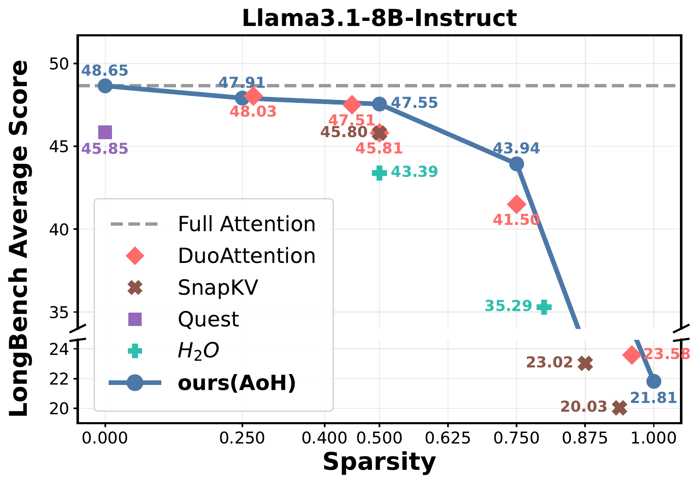
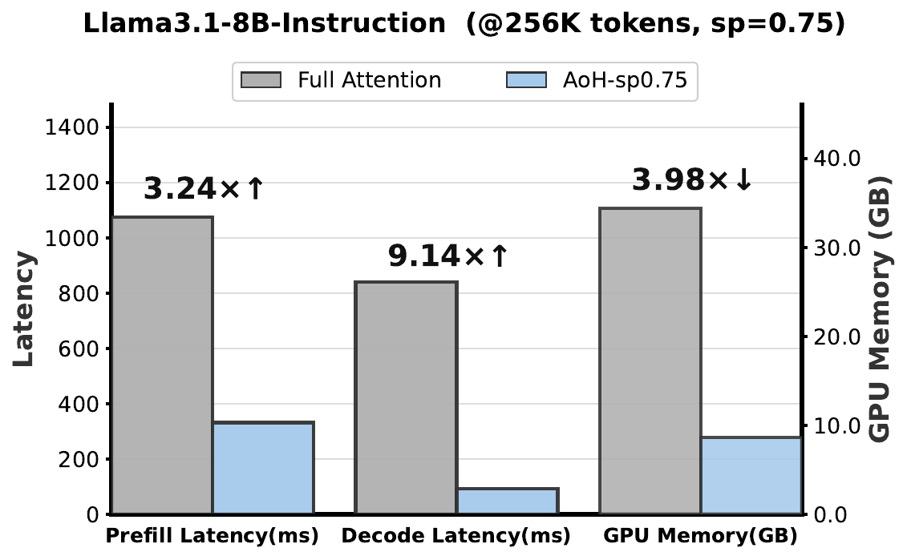
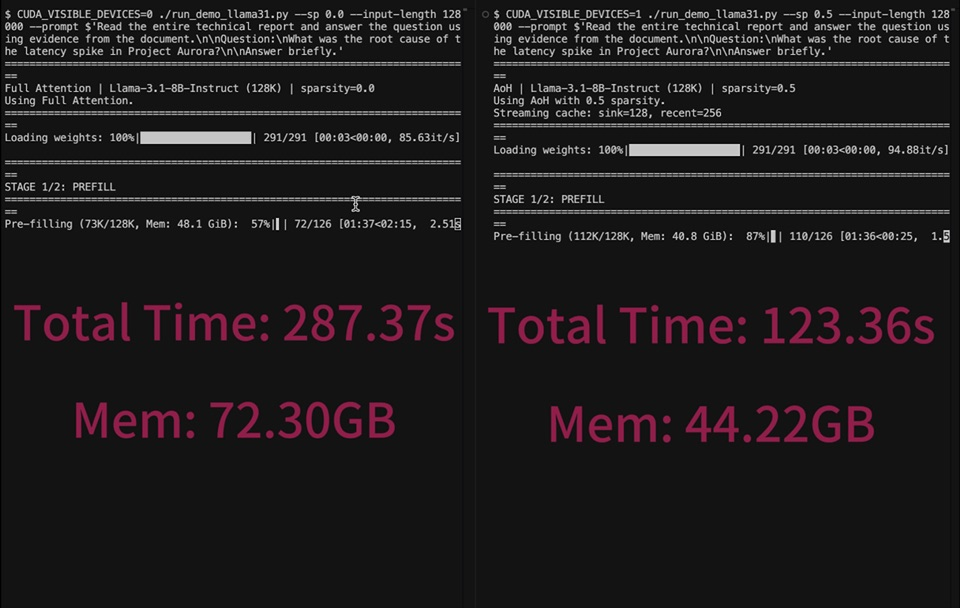
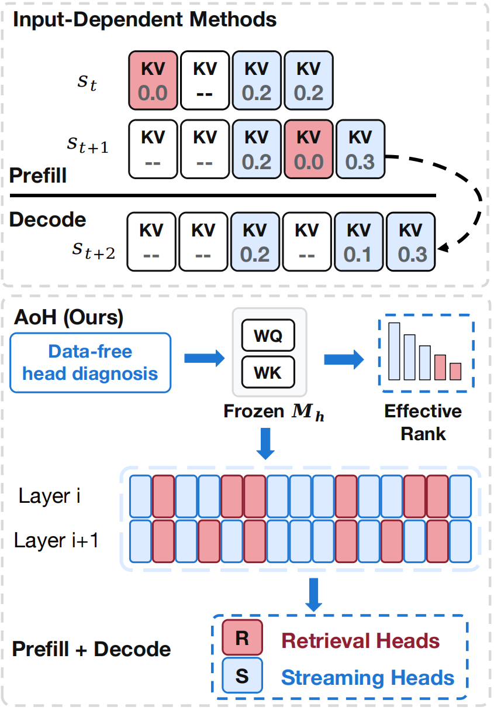

# AoH: Autonomy-of-Heads
**AoH (Autonomy-of-Heads)**, a training-free method that classifies attention heads from the frozen query-key projection geometry.
<div align="center">
  
  
</div>

Paper: [AoH paper](https://undground.fun/aoh/static/images/aoh-paper.pdf)

## Demo

[](assets/aoh-demo-0804.mp4)

*Click the image to watch the demo video.*

## Method
<div align="center">
  
</div>

For each query head, AoH measures the effective rank of the query-key interaction matrix using a small head-dimension Gram matrix. Low-rank heads are classified as retrieval heads and retain full attention; higher-rank heads are classified as streaming heads and can use a local attention window.

Both multi-head attention (MHA) and grouped-query attention (GQA) models are supported. For GQA, per-query-head scores are aggregated within each KV group using the mean, minimum, or maximum score.

## Installation

Python 3.10 or newer is required.

```bash
pip install -e .
```

Install plotting dependencies when visualization is needed:

```bash
pip install -e ".[visualization]"
```

Model weights are loaded through Hugging Face Transformers. Access to gated models must be configured separately with Hugging Face.

## Command Line

```bash
python -m aoh \
  --model_path Qwen/Qwen2.5-7B \
  --device cuda:0 \
  --sparsity 0.5 \
  --agg mean \
  --output_dir outputs/qwen25-7b
```

The installed `aoh` command provides the same interface:

```bash
aoh --model_path Qwen/Qwen2.5-7B --output_dir outputs/qwen25-7b
```

Useful options:

- `--sparsity`: fraction of heads classified as streaming in each layer.
- `--agg {mean,min,max}`: GQA score aggregation strategy.
- `--binary`: use binary projection weights for accelerated rank estimation.
- `--torch_dtype {auto,float32,float16,bfloat16}`: checkpoint loading dtype; `auto` preserves the stored dtype and is the default. AoH still performs the Q/K rank computation in float32.

Run `python -m aoh --help` for the complete interface.

## Python API

```python
from aoh import AoHClassifier

classifier = AoHClassifier(
    model_path="Qwen/Qwen2.5-7B",
    device="cuda:0",
    agg="mean",
)
labels = classifier.classify(sparsity=0.5)
classifier.save("outputs/qwen25-7b")
```

`labels` has shape `(num_layers, num_kv_heads)` for GQA models and `(num_layers, num_heads)` for MHA models. A value of `1` denotes a retrieval head and `0` denotes a streaming head.

## Outputs

Each run writes the following files to `--output_dir`:

- `head_classification.npy`: binary retrieval/streaming labels.
- `eff_rank.npy`: per-query-head effective ranks.
- `eff_rank_kv.npy`: effective ranks aggregated by KV group.
- `results.json`: model and run metadata.

## Examples

```bash
python examples/qwen25_7b.py
python examples/qwen3.py
```

The examples load full model weights. Adjust the model name, device, and output path in each script for your environment.

## Visualization

After running AoH:

```bash
python visualization/plot_head_classification.py outputs/qwen25-7b
python visualization/plot_effective_rank.py outputs/qwen25-7b
```

## License

Released under the MIT License. See [LICENSE](LICENSE).
